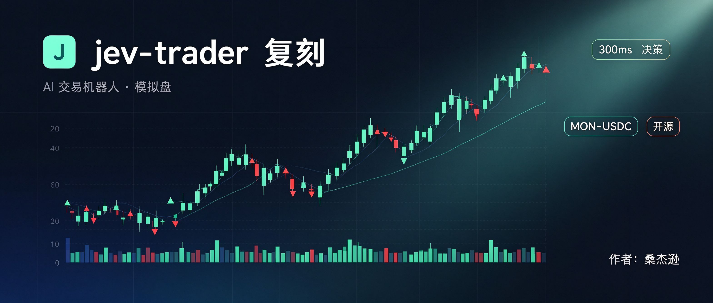

# jev-trader 复刻（模拟盘）

**作者：桑杰逊**

复刻自 [jarrodwatts/jev-trader](https://github.com/jarrodwatts/jev-trader) —— 文章
《JEV 爆火成为 AI 新宠：盘点 20+ 个最前沿的加密实战用例与叙事标的》（深潮 TechFlow）中
最先火起来的 JEV 案例：**每个 Monad 区块（约 300ms）看一眼 Kuru 的 MON-USDC 盘口，
让决策模型回答买/卖，然后挂一单 post-only 限价单（盘口内侧 1 tick，撤销上一单），
等 taker 来吃，赚价差而不是付价差。**

本仓库是它的**可运行复刻**：同样的主循环、同样的状态压缩、同样的决策模型（mock）、
同样的成交与盈亏核算、同样的 SSE 事件流，配一个浏览器看板。行情用内置模拟器
（原版默认也是 dry-run + mock，本环境无法访问 Monad/Kuru 公共 RPC）。

## 目录

```
jev-trader-replica/
├── server.js       Node 引擎：模拟行情 + 决策 + 挂单 + 成交 + 盈亏 + SSE（零依赖）
├── dashboard.html  自包含看板：直接双击打开即内嵌模拟运行；由 server.js 提供时自动切实时模式
└── README.md
```

## 快速开始

**方式一（推荐，无需安装）**：直接浏览器打开 `dashboard.html`。
页面内置完整引擎，以 300ms 一个区块的速度运行，可暂停 / 调速 / 重置，
并展示“模型所见”的压缩状态。

**方式二（Node 服务端）**：

```bash
node server.js
# 打开 http://localhost:3000
```

端点：
- `GET /` 看板（同一份 dashboard.html，浏览器自动探测并切到 SSE 实时模式）
- `GET /snapshot` 当前快照 `{ model, wallet, dryRun, latest }`
- `GET /history?n=1000` 最近事件
- `GET /events` SSE：连接即发 `snapshot`，之后每区块发 `block`，成交发 `fill`

## 复刻对照

| 模块 | 原版（Monad/Kuru 实盘结构） | 本复刻 |
| --- | --- | --- |
| 行情 | Kuru 盘口，`eth_call` 读 L2Book + AMM vault | 内置随机游走模拟器（同量级价差/深度/主动成交） |
| 决策模型 | JEV（TypeSafe `experimental_evaluate`，`MODEL=jev`）或 MockModel | 同款 MockModel；`MODEL=jev` 接入真实 JEV（见下） |
| 主循环 | 每区块 2 次 RPC 往返（读盘 + 发单），busy 则发 late/hold | 同逻辑（模拟），busy/迟到路径一致 |
| 挂单 | post-only 限价单，1 tick 内侧，batchUpdate 撤旧挂新 | 同（模拟），仓位上限约束 capped 一致 |
| 成交 | 实盘 receipt / Trade log；dry-run 用真实 prints 模拟成交 | 同 dry-run 规则：taker 穿过挂单价即成交 |
| 盈亏 | position 记账 + realized/unrealized - gas - JEV 成本 | 同公式（gas 按原版 dry-run 实测 0.0357 MON/单） |
| 事件流 | SSE snapshot / block / quote / fill | 同结构 |

`src/model.ts` 的 MockModel 公式被逐行保留：
`signal = returnsBps.last20/8 + bookImbalance*1.5 + cvdFlow*2 + hashNoise(block)`，
`sigmoid(signal)` 得买入概率，≥0.5 买、否则卖。为演示 late 路径，推理延迟
在 80ms 基准上加入 8% 概率的 220–480ms 抖动（模拟 JEV 官方 70–500ms 区间）。

## 配置（环境变量）

| 变量 | 默认 | 说明 |
| --- | --- | --- |
| `TRADE_SIZE_MON` | 200 | 每单挂单量（Kuru 最小 200 MON） |
| `MAX_POSITION_MON` | 1000 | 净持仓上限 |
| `BANKROLL_USD` | 100 | 收益率 pnlPct 的分母 |
| `HORIZON_BLOCKS` | 100 | 模型被问的窗口（~30 秒） |
| `BLOCK_MS` | 300 | 模拟出块间隔 |
| `MODEL` | mock | `mock` 启发式；`jev` 接真实 JEV |
| `PORT` | 3000 | 服务端口 |

## 接入真实 JEV

本复刻不内置 TypeSafe 的 `ai` SDK。要跑真实 JEV：

```bash
npm i ai @ai-sdk/typesafe-ai
MODEL=jev TYPESAFE_AI_API_KEY=xxx node server.js
```

按原版 `src/model.ts` 的 `JevModel` 实现即可（`experimental_evaluate` + `typeSafeAi.evaluationModel('jev-latest')`，
问题模板与 criteria 已在原仓库，未随本仓库分发）。

## 为什么不接实盘

1. JEV 判断“快到能跟上出块”是它的卖点，但**方向对 ≠ 赚钱**：maker 策略在行情平静时赚价差，
   单边行情里会被逆向选择吃穿（作者原话：这不是稳赚策略）。
2. 实盘还要处理 margin、非ce、gas 竞态、MEV——那是另一个量级的工程。
3. 本复刻用于学习架构与观察“AI 高频决策循环长什么样”，不是交易建议。

## 免责

模拟盘演示，非实盘，不构成投资建议。JEV 是 TypeSafe AI 的专有模型；文中的 JEV 概念代币
（JevBall / Just Jev 等）均非官方发行，风险极高，DYOR。
